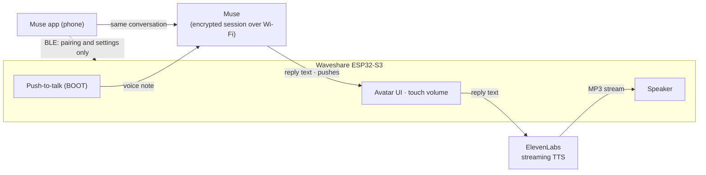
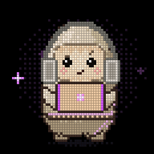

# Waveshare × Muse Gadgets

**Meta's [Muse Gadget SDK](https://github.com/facebookincubator/muse-gadget-sdk), running on three round and square Waveshare ESP32-S3 boards — and talking back out loud.**

<p align="center">
  
  <br>
  <sub>Muse on all three: the <b>LCD 1.85C</b> in its speaker enclosure (back), the round <b>AMOLED 1.43C</b> (front) and the <b>AMOLED 1.8</b> waiting for Wi-Fi (right).</sub>
</p>

This is a fork of `facebookincubator/muse-gadget-sdk` that adds three Waveshare boards to the ESP32 Device SDK, plus a few features the upstream firmware doesn't have yet: spoken replies, replies you didn't ask for (pushes), touch volume and battery level on boards without a power chip.

> **This fork** is maintained by [Derek Ngo](https://github.com/mbndrock) and builds on [David Ruiz's fork](https://github.com/wupsbr/waveshare-muse-gadget-sdk) above. Its own additions, marked **This fork** in the table below: an **on-device ElevenLabs voice switcher** (Settings › Voice), **replies that start speaking sentence by sentence** instead of waiting for the full text, and **git hooks that block commits and pushes which would publish your SDK token or API keys**.

> **This branch (`obd-vtec-reaction`)** is the S2000 branch. On top of everything below, it gives the AMOLED-1.8 a car mode: it links over BLE to a LELink^2 OBD-II adapter, reacts to VTEC and to hot coolant, wears a racing helmet and shows what the ECU answers on three swipeable car data cards while it's connected, and answers questions about it through a new `obd.read` command. A Settings switch turns all of it off. See [In the car](#in-the-car-the-obd-reactions-and-readout). It lives only on this branch and is not merged to `main`.

| | Waveshare ESP32-S3-Touch-LCD-1.85C | Waveshare ESP32-S3-Touch-AMOLED-1.43C | Waveshare ESP32-S3-Touch-AMOLED-1.8 |
|---|---|---|---|
| Screen | 1.85" round LCD, 360×360, ST77916 (QSPI) | 1.43" round AMOLED, 466×466, SH8601 (QSPI) | 1.8" AMOLED, 368×448, SH8601 or CO5300 (QSPI) |
| Touch | CST816 | FocalTech-style @ 0x15 | FT3168 or CST816 |
| Audio | ES8311 + amp, ES7210 dual mic | ES8311 + NS4150B, ES7210 dual mic | ES8311 (speaker and mic) |
| Power | No PMU · battery by ADC | No PMU · battery by ADC + charge pin | AXP2101 |
| Flash / PSRAM | 16 MB / 8 MB octal | 8 MB / 8 MB octal (PICO-1-N8R8) | 16 MB / 8 MB octal |
| Talk button | BOOT | BOOT | BOOT (PWR is aux) |
| Alias | `s185c` | `s143c` | `s18` |

All three run the **full Muse UI**: animated avatar, push-to-talk, touch settings, images from Muse, the home-network tunnel and OTA. They are community ports and **experimental**.

## What's new compared to upstream

The short version is below; [`docs/CHANGES-FROM-UPSTREAM.md`](docs/CHANGES-FROM-UPSTREAM.md) has every change, why, and its default.

| Feature | What it does | Where |
|---|---|---|
| 🗣️ **Spoken replies** | Every reply is read aloud through the speaker with [ElevenLabs](https://elevenlabs.io) streaming TTS, captions following the speech. Audio starts ~1 s after the text arrives. Without a key, replies stay text. | `components/muse/muse_chat_session.cpp` (`start_tts`, `tts_fetch`), `Kconfig` |
| 🎙️ **Voice switcher** (**This fork**) | Pick the ElevenLabs voice on the device itself, in **Settings › Voice**. List up to 8 voices in `secrets/elevenlabs_voices` (`Name=voice_id` per line); tapping one previews it ("Hi, I'm …") and saves the choice in NVS, so it survives reboots and reflashes. The row appears when an ElevenLabs key and two or more voices are set; without the file the device keeps the single configured voice. | `components/muse/muse_voices.c`, `muse_settings_ui.c`, `tools/muse/secrets.py` |
| ⚡ **Replies spoken sooner** (**This fork**) | A reply no longer waits to be complete before it is spoken. Once a sentence of 30+ bytes has arrived it goes to ElevenLabs, and the rest follows a piece at a time, each piece carrying what was already said as context. First audio lands about 1 s after Muse's first text. | `components/muse/muse_chat_session.cpp` (`tts_pump`, `muse_hatch_speech_cut`) |
| 🛡️ **Secrets hooks** (**This fork**) | Optional `pre-commit` / `pre-push` git hooks scan outgoing changes for the real SDK token and ElevenLabs key (whole or in part) and for token-shaped strings, and block the commit or push before anything leaks. They report where, never what. Enable once per clone: `git config core.hooksPath .githooks`. | `.githooks/`, `tools/muse/check_secrets.py` |
| 💻 **Working pose** (**This fork**) | Thinking looks like the Muse app: Jollybot works on a laptop, grey headphones on, eyes down on the screen, instead of the paw-on-chin pose with thought dots (see [The working pose](#the-working-pose)). | `esp32/avatar/muse_pixel.c` (`draw_laptop`, `draw_headphones`, `eyes_update`) |
| 🔆 **Display page** (**This fork**) | Brightness moves out of the Sound page onto its own **Settings › Display** page, and the slider stops fighting the page swipe: the preview is applied once per frame instead of synchronously in the touch handler. | `components/muse/muse_settings_ui.c` |
| 🔇 **Touch volume switch** (**This fork**) | **Settings › Sound › Touch volume** (on by default) turns the face volume drag off entirely, for anyone who keeps changing the volume by accident. | `components/muse/muse_settings_ui.c`, `muse_ui.c` (`volume_drag`) |
| ⏳ **Longer voice turns** (**This fork**) | A voice turn no longer fails with NO REPLY after 60 s of Muse thinking: the reply timeout is 180 s, a busy agent holds the turn instead of timing out, and the turn cap is 10 minutes. Typed turns already worked this way. | `components/muse/muse_chat_session.cpp`, `muse_chat_link.c` |
| 📬 **All messages** | Optional, **off by default** (Settings › All messages). When on, Muse messages that arrive with no question pending — Muse writing first, or replying to something you typed in the app in the same conversation — wake the screen and are shown and spoken, and the session stays connected so they keep arriving. Off saves battery. | `muse_chat_session.cpp` (`push_begin`), `muse_voice.c` (`play_push`) |
| 🔊 **Touch volume** | Drag up or down on the avatar screen to change the volume; a cyan ring on the edge shows the level and fades after 2 s. Horizontal swipes still open settings. | `components/muse/muse_ui.c` (`volume_drag`) |
| 🔋 **Battery** | Settings › Battery shows just the **percentage** and an estimate of the **time left** at the current drain. The 1.85C and 1.43C read it through the ADC (they have no power chip). | `boards/board_waveshare_s3_185c.c`, `boards/board_waveshare_s3_143c.c` |
| 🧊 **Display freeze fix** | Cherry-picked from upstream [PR #34](https://github.com/facebookincubator/muse-gadget-sdk/pull/34): LVGL could starve the band sender and freeze the screen after ~20 min. | `boards/muse_lcd_bands.c` |
| 🐕 **Watchdogs** | Turned back on for these boards: a stuck task panics with a backtrace and reboots instead of leaving the board dead until RST. | `devices/sdkconfig.muse-waveshare-s3-*` |
| 😵 **Avatar reactions** | Shake Muse and it gets dizzy (boards with a QMI8658 accelerometer, found by probing). Before the screen goes dark Muse drowses for 4 s with a quiet snore, and it wakes up when the screen comes back on. Jollybot draws all three (see [New avatar reactions](#new-avatar-reactions)). | `components/muse/muse_imu.c`, `muse_input.c` (`check_sleep`, `check_shake`), `muse_voice.c` (`play_snore`) |
| 🤭 **Tickle** | Rub Muse's face quickly back and forth, or tap it four times fast, and Muse giggles for as long as you keep going, then catches its breath. Taps, the volume drag and the swipe to settings work as before. Jollybot draws it (see [New avatar reactions](#new-avatar-reactions)). | `components/muse/muse_ui.c` (`touch_read`, `tickle_poll`), `muse_state.c` |
| 🏎️ **VTEC reaction, coolant warning and warm-up thumbs-up** (AMOLED-1.8 only, this branch) | In the car, the board connects over BLE to a LELink² ELM327 OBD-II adapter beside its own phone link and polls engine RPM. Crossing 6000 rpm (armed below 5500, at most once every 30 s) makes Muse buzz with a **VTEC!** banner. Every other request reads a secondary PID, coolant temperature first: 105 °C or more for 5 s with the engine running makes Muse fret, sweating and steaming under a **HOT!** banner (once, then not again until it's back down to 100 °C, at most once every 2 minutes; it outranks VTEC). When the coolant first reaches 82 °C after a reading of 70 °C or less, Muse gives a pleased **thumbs-up** (below both of the others). All three are visual only. While the board is linked to the adapter, an **OBD** label shows in the face's status row and Muse wears a **racing helmet**, visor up. Settings › **OBD** turns the whole feature off, connection included, and back on. Off on every other board (`CONFIG_MUSE_OBD_VTEC`). | `components/muse/muse_obd.c`, `muse_obd_elm.c`, `devices/sdkconfig.muse-waveshare-s3-18` |
| 🔎 **OBD readout and car data cards** (AMOLED-1.8 only, this branch) | Muse can be asked what the car is doing. The `obd.read` Link command reports the adapter's link state, the negotiated OBD protocol, which PIDs the ECU supports, and the latest RPM, coolant, intake and ambient air temperature, timing, load, MAP, speed, throttle and fuel trims, each with its age in milliseconds, or null when there is no current reading. The same snapshot prints on the USB serial console as `>obd`. Three swipeable cards between the face and settings (Temps, Engine, Drive) show the same readings on screen while the adapter is connected; without it the screen is the usual face and settings. | `components/muse/muse_obd.c` (`muse_obd_status`), `main/app.c`, `main/noise_control.cpp` |
| 🔐 **Secrets outside git** | The SDK token and API keys live in `secrets/` (gitignored) and are injected into each build's generated `sdkconfig`. | `secrets/`, `tools/muse/secrets.py` |



## In the car: the OBD reactions and readout

This branch turns the AMOLED-1.8 into a very small, very opinionated co-driver for a Honda S2000.

**What you need.** A LELink^2 Bluetooth LE ELM327 adapter plugged into the car's OBD-II port (driver's side, under the dash). The ESP32-S3 is BLE-only, so the cheap Bluetooth Classic ELM327 clones can never work with it; the adapter has to speak BLE. The LELink^2 advertises as "LELink BLE OBDII", with service FFE0 and a single characteristic, FFE1, for both writes and notifications.

**How it connects.** There is nothing to pair and nothing to configure on the board. When the adapter is in range and awake, the firmware finds it by name or service UUID, connects as a BLE central beside its own phone link, subscribes to FFE1, runs the usual ELM init (`ATZ`, `ATE0`, `ATL0`, `ATH0`, `ATS0`, `ATSP0`), asks the ECU which PIDs it supports (`0100`, then `0120` and `0140` if it says there are more) and which protocol it answered on (`ATDPN`), and then polls Mode 01: RPM (`010C`) on every other request, and in between one secondary PID in turn, coolant (`0105`) first and then the cards' PIDs, skipping any the ECU said it doesn't have. If the link drops (ignition off, out of range), it reconnects on its own, with a backoff that grows from 2 s to 60 s. 2000-2005 S2000s (AP1) talk K-line (ISO 9141-2); 2006 and later cars, drive-by-wire like the 2008 AP2, talk CAN (ISO 15765-4). The firmware doesn't need to know which: `ATSP0` auto-detects it, and `obd.read` reports what was negotiated as `protocol`.

**The reactions.** Crossing 6000 rpm after being armed below 5500 plays the VTEC reaction. Coolant at 105 °C or more for 5 s with the engine running plays the coolant warning. When the engine warms up, Muse raises a paw beside his head with a thumbs-up: it arms on a coolant reading of 70 °C or less, fires once on the first reading of 82 °C or more, and re-arms only after another reading of 70 °C or less. A drive first seen already warm (a hot restart, or a reconnect mid-drive) never fires it, and every new connection to the adapter has to see the engine cold again. It ranks below the coolant warning and VTEC, so it never covers either. The exact arming, cooldown and priority rules are in the feature table above. The reactions are visual only, with no spoken line: speech would swap the reaction face for the speaking pose and hide it. They are drawn locally, so they work with no network at all.

**Is it connected?** While the board is linked to the adapter, a small **OBD** label sits in the status row at the top of the face, between the Bluetooth icon and the battery. It is dim once the adapter's notifications are on and turns the accent colour while RPM and coolant are being polled. It is hidden otherwise, and the Wi-Fi, Bluetooth and battery items stay put when it comes and goes. For as long as the label shows, Muse also wears a racing helmet: a light shell with a stripe in the accent colour, the visor raised so his face and every reaction still show. The car data cards are there for that time too (below).

**Asking Muse what the car is doing.** The `obd.read` Link command returns the adapter state and the latest readings:

```json
{"state": "polling", "enabled": true, "adapter_found": true, "connected": true, "subscribed": true,
 "polling": true, "rpm": 850, "rpm_age_ms": 120, "coolant_c": 91, "coolant_age_ms": 450}
```

A reading is null when there is none right now: engine off (the ECU answers NO DATA), adapter asleep, or link down, and a dropped link clears every reading instead of reporting stale ones. With the engine off but the adapter awake, the state stays "polling" and RPM is null, which is the honest answer. The other readings' ages run larger than RPM's, because each secondary PID is asked for only once per cycle of up to ten.

The same reply also has `load_pct`, `map_kpa`, `speed_kmh`, `timing_deg`, `iat_c`, `throttle_pct`, `stft_pct`, `ltft_pct` and `ambient_c`, each with an `_age_ms` beside it (`load_age_ms`, ..., named like `coolant_age_ms`), plus the discovery payload: `protocol` (for example `"CAN 11/500"`, null until known) and the supported-PID bitmasks `supported_00`, `supported_20` and `supported_40` as 8 hex digits (`"BE1FA813"`), null when not read. The protocol and the masks stay after the link drops, so they can still be read after the drive.

**The cards.** While the adapter is connected (the **OBD** label is showing), swipe left from the face for three car data cards before settings: **Temps** (coolant, intake air, ambient), **Engine** (RPM, timing advance, load, MAP) and **Drive** (speed, throttle, short- and long-term fuel trim). They read like a gauge cluster: the cells fill the screen between the title and the page dots, each with a small label above a big number (Montserrat 40). RPM and the speed in mph are the big ones (48, twice the height), each with a thin bar under it for RPM (0-8000) and throttle (0-100 %); km/h sits on a small line under the mph, and the two fuel trims share a row. Coolant turns amber at 100 °C and red at 105 °C, and a fuel trim turns amber at ±10 %. A value older than 3 s is dimmed, and `...` means nothing has arrived yet. A PID the ECU says it doesn't support disappears from its card altogether once the support scan is in, and the card's other cells grow to fill the space. Before the polling starts, each card shows the link state (discovering, initializing) instead of numbers. When the link drops, the cards go and the screen is the face and settings again, as on a board without the feature. If you're on a card at that moment, you land on the face; if you're in settings, you stay there.

**The trip log.** Every drive is recorded. From the moment polling starts until the link drops, each RPM reply adds a row to a CSV for that trip, with the time since the start in ms and the latest RPM, coolant, intake air, timing, MAP, load, throttle, speed, both fuel trims and ambient (an empty field until a channel has a value). A few `#` lines at the top give the firmware commit, the trip id, the protocol, the supported-PID masks and the start time (or `t0=boot` when the clock isn't set), and a `# end samples=N dropped=M` line closes it. Trips go to the board's own flash, in a 7.8 MB `obdlog` FAT partition after the app slots (roughly a week of commuting at about 1 MB an hour); a microSD card would come first, but the AMOLED-1.8's TF slot has no driver yet. Logging never slows the polling: rows are queued and written in 4 KB blocks by a low-priority task, and any that can't keep up are counted as dropped. The board never deletes a trip by itself. When the store is full it stops logging (`log_full`) and keeps what it has.

Muse pulls trips over Link with three commands, which work with OBD turned off too:

- `obd.trips` lists the completed trips: `{"trips": [{"id", "store", "bytes", "samples", "dropped", "started", "ended", "crc32"}], "card", "flash", "logging"}`. `store` is `"flash"` (or `"sd"`), the times are Unix seconds or null, and `crc32` is zlib's CRC-32 of the whole file.
- `obd.trip_read {"id", "offset"}` returns up to 6144 bytes of the file from `offset`, base64-encoded: `{"id", "offset", "bytes", "total", "eof", "data"}`.
- `obd.trip_delete {"id"}` deletes a trip, for when Muse has checked that what it pulled matches `bytes` and `crc32`. It is the only way a trip is ever deleted.

`obd.read` reports the log too: `log_card`, `log_flash`, `log_store` (where the current or next trip goes), `log_active`, `log_trip`, `log_dropped`, `log_full`, and `log_pending`, the number of trips waiting to be pulled, which is the flag Muse checks after a drive. The partition arrives with the next flash of this branch. The app and NVS keep their offsets, so pairing, Wi-Fi and Settings survive, and a trip log that's already there survives later reflashes.

**Turning it off.** Settings › **OBD** (on by default, saved across reboots) turns the whole feature off: the board stops scanning, drops a link that's up, and makes no connection attempts at all, which leaves the adapter free for a phone app. There's no label, no cards, no helmet and no reactions, and `obd.read` reports `"state": "off"` with `"enabled": false` and null readings. A trip in progress is closed. Turning it back on starts looking for the adapter again, without a reboot.

**On the bench.** The USB serial console takes five extra commands in this build: `>vtec`, `>coolant` and `>warmup` force the three reactions with no car attached (they leave the triggers alone; with OBD turned off they answer `@obd.off` instead), `>obd` prints the same snapshot as `obd.read`, as one `@obd {...}` line, and `>card <n>` slides the screen to tile n (0 the face, 1-3 the cards, 4 settings). The cards' numbers only work while the adapter is connected, and otherwise answer `@card.error no cards: the OBD link is down`.

**Gotchas.**

- The adapter accepts one BLE connection at a time. If a phone OBD app is connected to it, the board cannot get in; close the app first. The other way round, turn OBD off in Settings to let the phone have it.
- Both sides have to be awake: the adapter sleeps with the car off, and the board only polls while it is powered.
- Everything here is read-only. The firmware sends nothing to the car beyond ELM setup commands and PID requests; it cannot clear codes or change ECU settings.

**Building it.** Only the s18 overlay turns the feature on (`CONFIG_MUSE_OBD_VTEC=y` in `devices/sdkconfig.muse-waveshare-s3-18`, together with the NimBLE central and observer roles and a second BLE connection). Build and flash as usual:

```sh
cd esp32
tools/muse/board.sh build s18
tools/muse/board.sh flash s18
```

Every other board builds exactly as before, with the code compiled out.

## New avatar reactions

Muse now reacts to the world a little, like a toy that gets dizzy when you shake it.

> 💡 These ideas — getting dizzy, dozing off with a snore, waking up, and now giggling when tickled — came from watching my 8-year-old son **Bernardo** play with Jollybot and Muse. Thanks, Bernardo!


<table>
  <tr>
    <td align="center"><br><b>Dizzy</b><br><sub>Shake the board</sub></td>
    <td align="center"><br><b>Sleepy</b><br><sub>Right before the screen goes dark (with a soft snore)</sub></td>
    <td align="center"><br><b>Waking</b><br><sub>When the screen comes back on</sub></td>
    <td align="center"><br><b>Tickled</b><br><sub>Rub his face quickly, or tap fast</sub></td>
  </tr>
</table>

- **Dizzy** needs the QMI8658 accelerometer. The firmware probes for it at boot: the AMOLED 1.8 has one, and the log says whether the others do. Three quick back-and-forth swings count as a shake; a tap or picking it up doesn't.
- **Sleepy** plays for the last 4 s before auto-sleep; touching or pressing anything cancels it. Two quiet snores play if Speaker is on.
- **Waking** plays for 1.5 s every time the screen turns on.
- **Tickled**: rub his face quickly back and forth, or tap it four times fast. He giggles for as long as you keep going, then catches his breath. A single tap still gives hearts.

The timing, the sensor and the snore are part of the firmware (Apache 2.0). The drawing is in Jollybot itself — please read the note below.

### About the Jollybot avatar

Jollybot (`esp32/avatar/`) is **Meta's character** and is **not** covered by the Apache License, as Meta's own README states. This fork adds complementary animations to it: dizzy, sleepy, waking, tickled, VTEC, the coolant warning, the warm-up thumbs-up and the racing helmet, plus the previews above. **These animations and images are not covered by the Apache License either**; they share the character's status. We claim no rights to Jollybot or to these additions and charge nothing for them. They're a fan contribution, and we'll remove them at Meta's request: [wupsbr@gmail.com](mailto:wupsbr@gmail.com). With the reactions idle, Jollybot renders exactly as Meta made him.

### The working pose

This fork (Derek's) also changes one of Meta's own animations. While Muse is thinking, Jollybot no longer leans on one paw under a trail of thought dots: he works on a laptop, the way the Muse app shows him working. The screen faces him, so you see the back of the lid with its little lit logo; he wears plain grey headphones, a band over the hood and pale over-ear cups; his arms reach the deck and tap as he types, and his eyes stay on the screen. The drawing is part of Jollybot, so it carries the same status as the note above: not covered by the Apache License.

<p align="center"><br><b>Working</b><br><sub>While Muse is thinking</sub></p>

## Quick start

You need a Mac or Linux machine, a **USB-C cable that carries data** (charge-only cables are a common trap), one of the boards, a [Muse SDK token](https://gadgets.muse.ai/settings/sdk-tokens) and the Muse app.

**1. Install ESP-IDF v6.0.1** (the only version the SDK supports):

```sh
brew install cmake ninja dfu-util python3          # macOS
git clone -b v6.0.1 --recursive https://github.com/espressif/esp-idf.git ~/esp/esp-idf-v6
~/esp/esp-idf-v6/install.sh esp32s3
```

**2. Add your secrets** (see [`secrets/README.md`](secrets/README.md)):

```sh
git clone https://github.com/mbndrock/waveshare-muse-gadget-sdk && cd waveshare-muse-gadget-sdk
cp secrets/muse_sdk_token.example secrets/muse_sdk_token            # paste your mgst_… token
cp secrets/elevenlabs_api_key.example secrets/elevenlabs_api_key    # optional: spoken replies
chmod 600 secrets/*
```

**3. Build and flash** (`s185c`, `s143c` or `s18`):

```sh
cd esp32
tools/muse/board.sh build s185c
tools/muse/board.sh flash s185c
```

`board.sh` finds ESP-IDF on its own, copies the secrets into `build-muse-<board>/sdkconfig` and prints only which ones it set. For a clean first install, erase the board first: `python -m esptool -p /dev/cu.usbmodem… erase-flash`.

**4. Pair.** In the Muse app turn on **Settings › Devices › Developer mode**, tap **+**, pick `MuseGadget-XXXXXX` (the name is on the board's screen) and press **BOOT** when the screen asks. Then send it your Wi-Fi from the app.

**5. Talk.** Hold **BOOT**, speak, let go.

## Using Claude Code? Let it do the work

This repo is set up for [Claude Code](https://claude.com/claude-code). [`CLAUDE.md`](CLAUDE.md) gives it the boards, the build and flash flow, how to read logs without resetting the board, the hardware traps and, above all, the rules that keep your token and keys out of chat, logs and git. The **`flash-muse-board`** skill (`.claude/skills/`) does the whole flash: it finds the board, backs it up, identifies the model, builds, flashes and checks the boot log.

```sh
git clone https://github.com/mbndrock/waveshare-muse-gadget-sdk && cd waveshare-muse-gadget-sdk
cp secrets/muse_sdk_token.example secrets/muse_sdk_token    # paste your token yourself, not in the chat
claude
```

Then just ask:

> I plugged in a board. Find out which one it is and flash Muse on it.

> Watch the serial log and tell me when it's ready to pair.

> The screen froze after a while. Find out why.

> Make the replies use my ElevenLabs voice `<voice id>`.

> Add support for my Waveshare ESP32-S3-Touch-AMOLED-2.06.

> What's new upstream since our last sync? Merge what's useful.

Claude asks before anything destructive, like `erase-flash` or overwriting a backup. Flashing needs the USB port, so run Claude outside a sandbox, or allow the esptool commands.

## Hardware notes

Things that cost us time, so they don't cost you:

- **Back up the factory firmware first:** `python -m esptool -p PORT read-flash 0 0x1000000 factory.bin` (`0x800000` on the 8 MB 1.43C). It's the only way back to the vendor demo.
- **Identify the exact model** before flashing: the 1.85**C**, 1.43**C** and 1.8 differ from their non-C siblings. `esptool chip-id` plus `strings factory.bin | grep -i board` usually names it.
- **1.85C side header:** `E5`–`E8` are the TCA9554 expander's pins, not ESP32 GPIOs, and `19`/`20` are the USB data lines — using them as GPIO kills flashing and the console. The header's SDA/SCL are the same internal I2C bus (GPIO 11/10) as touch, RTC, codecs and expander.
- **1.85C buttons:** only BOOT is readable. RST resets the chip and the slide switch disconnects the battery.
- **1.85C panel revisions:** register `0x04` reads `00 02 7f 7f` on the revision that needs Waveshare's long vendor init sequence; the board file checks it.
- **1.43C** is mounted upside down: `MADCTL 0xC0`, and touch is flipped on both axes. PWR drives a hardware power latch, not a GPIO.
- **1.8** comes in two revisions (SH8601 + FT3168, or CO5300 + CST816). The board file probes the touch controller to tell them apart.
- **ElevenLabs over HTTPS** needs `CONFIG_MBEDTLS_CERTIFICATE_BUNDLE_CROSS_SIGNED_VERIFY=y`: `api.elevenlabs.io` sends GTS Root R1 cross-signed by a GlobalSign root that's no longer in ESP-IDF's bundle.
- **USB hubs and docks** can drop the board for minutes, which looks exactly like a firmware hang. Flash and monitor straight from the computer's port.

## Repository layout

```
esp32/                                   Meta's ESP32 Device SDK, plus:
  components/muse/boards/
    board_waveshare_s3_185c.c            1.85C: ST77916, CST816, TCA9554, ES8311/ES7210, ADC battery
    board_waveshare_s3_143c.c            1.43C: SH8601, touch @0x15, ES8311/ES7210, ADC battery
    board_waveshare_s3_18.c              1.8: SH8601/CO5300, FT3168/CST816, AXP2101
  devices/sdkconfig.muse-waveshare-s3-*  board overlays
  tools/muse/secrets.py                  secrets → build sdkconfig
secrets/                                 your token and keys (gitignored)
CLAUDE.md, .claude/skills/               guidance and a flash skill for Claude Code
linux/  skills/  protocols/              upstream, unchanged
android/  ios/                           upstream: Muse Gadgets Test (video from a phone)
web-flasher/                             upstream: the web flasher
README.meta.md                           upstream README
```

Each board is also documented the upstream way in [`esp32/devices/README.md`](esp32/devices/README.md) and [`esp32/AGENTS.md`](esp32/AGENTS.md).

## From upstream

Everything Meta ships comes along; the last merge took upstream `main` at `e6fe517` (2026-10-21). Highlights since the previous sync:

- **Video from a phone over Wi-Fi:** [Muse Gadgets Test](android/musegadgetstest) ([iPhone](ios/musegadgetstest)) streams the phone's camera, or a clip, to a gadget's screen; H.264 or VP8 is decoded on the board. [`protocols/VIDEO.md`](protocols/VIDEO.md) explains how.
- **`display.draw_file`:** an image from the VM over the Noise session.
- **BLE commands:** Muse can drive the Link's Bluetooth LE.
- **SDK token over serial and from the [web flasher](web-flasher)**, and the Settings rework (the VM in the VM ID row, the real device token state).
- **Voice turns** stay open while Muse works, a capped turn with no reply fails cleanly, and an oversized reply says "reply too long". This fork keeps its longer timeouts on top (see [Longer voice turns](#whats-new-compared-to-upstream)).
- **Drawing in step with the panel's tearing-effect signal** (Waveshare 1.75/1.75C, ESP-Mosaico).
- **New boards:** Waveshare ESP32-S3-Touch-LCD-1.28, ESP32-S3-Touch-AMOLED-2.16, ESP32-C6 AMOLED 2.06 watch and ESP32-S3-1.54inch-ePaper V2, Espressif ESP-Mosaico (ESP32-S31), OSTB EchoEar-2ST, FoloToy AI Passport, a Vietnamese 1.83" ESP32-S3 board, reTerminal Sticky Muse and Link e-paper profiles. Upstream also added its own 1.85C board; this fork keeps its own 1.85C file.
- **Battery-input power profiling:** the [porting recipe](esp32/docs/power/README.md) and [power_sweep.py](esp32/tools/power/power_sweep.py); fixture safety and explicit hardware authorization come first, as the [PPK2 rules](esp32/docs/power/ppk2.md) describe.
- **Linux Device SDK:** LinkSession chat subscription, speech streaming, voice notes, spoken-reply requests and MuseTurn.

Meta's own README, current as of that merge, is [`README.meta.md`](README.meta.md).

## Staying in sync with upstream

```sh
git remote add upstream https://github.com/facebookincubator/muse-gadget-sdk.git
git fetch upstream && git merge upstream/main
```

## Security

- Your **SDK token and ElevenLabs key are compiled into the firmware.** Don't share a `build-*/` directory or a flashed image. If a key leaks, revoke it (gadgets.muse.ai, elevenlabs.io) and rebuild.
- Pairing is community pairing (button press, no manufacturer attestation): pair on a network you trust.
- Consider `CONFIG_HOMEHUB_NVS_ENCRYPTION` so Wi-Fi credentials and device tokens aren't readable from flash.

## Author

**David Ruiz** — [wupsbr@gmail.com](mailto:wupsbr@gmail.com)

Building something with Muse gadgets, or got one of these boards talking? Let's keep in touch: [linkedin.com/in/wupsbr](https://www.linkedin.com/in/wupsbr/). Issues and pull requests are welcome.

## Maintainer of this fork

**Derek Ngo** — [github.com/mbndrock](https://github.com/mbndrock)

Derek maintains this fork; its additions (the voice switcher, sooner speech and the secrets hooks) were built with Claude Code. Questions about this fork: open an issue in this repo. Questions about the Waveshare port itself belong with David's original fork above.

## License and credits

Apache License 2.0, like upstream — see [`LICENSE`](LICENSE) and [`NOTICE`](NOTICE). Built on [facebookincubator/muse-gadget-sdk](https://github.com/facebookincubator/muse-gadget-sdk) by Meta. Board details come from Waveshare's examples and schematics; panel and codec drivers from Espressif's component registry. The display-freeze fix is from upstream PR #34 by @toddsherman. Not affiliated with Meta, Waveshare or ElevenLabs. This fork's own changes are the rows marked **This fork** in [What's new compared to upstream](#whats-new-compared-to-upstream).

Third-party code keeps its upstream license, as listed in [`README.meta.md`](README.meta.md#license): minimp3 (CC0-1.0), the ESP-VoCat panel sequence in `ostb_echoear_display_init.h` (MIT), Adafruit's `pixel_font.c` (BSD-2-Clause), the SSD1677 refresh sequence in `epd_ssd1677.c` (MIT), AOSP's H.264 decoder in `components/tinyh264` (Apache-2.0) and libvpx's VP8 decoder in `components/libvpx_vp8` (BSD-3-Clause, with Google's patent grant). Muse Gadgets Test can use x264 (GPL-2.0) on the phone; this repository carries none of its code, but an app you build with it is under the GPL.

> Built by hackers, for hackers, just for fun. Flashing custom firmware can brick boards and void warranties. Proceed at your own risk!
